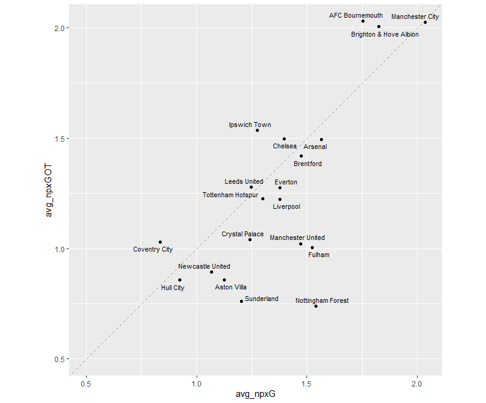
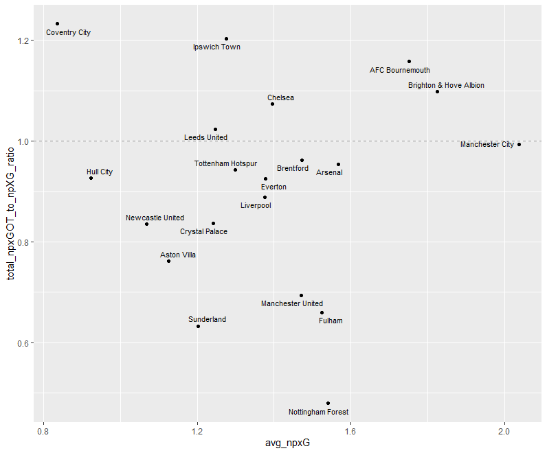
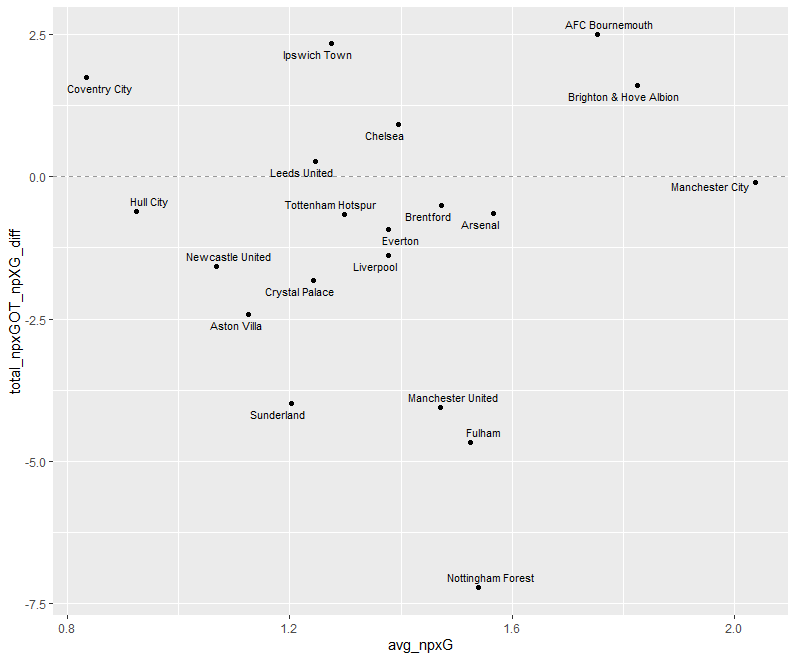

# Non-penalty xG vs Non-penalty xGOT in the Premier League

## Introduction
We look at three plots comparing a club's chance creation to their shot quality, using the 2026-27 Premier League season up to matchweek 9 (data scraped from FotMob). 

Chance creation is given by the average non-penalty xG per match. To compute a team's shot quality, we look at two related but slightly different stats: the ratio between a club's total accumulated npxGOT and npxG, or the difference between the two. 

## Data

The plots are generated in [xGplot.R](xGplot.R):
1. Average npxG vs average npxGOT per match

2. Average npxG vs npxGOT / npxG ratio

3. Average npxG vs npxGOT − npxG difference

The full table, computed in the same script and saved as [pl_xgot_table.csv](pl_xgot_table.csv) (totals over the season so far, rounded to two decimals):

| Club | Matches | npxG | npxGOT | npxG / match | npxGOT / match | npxGOT / npxG | npxGOT - npxG |
|---|---:|---:|---:|---:|---:|---:|---:|
| AFC Bournemouth | 9 | 15.77 | 18.26 | 1.75 | 2.03 | 1.16 | +2.49 |
| Arsenal | 9 | 14.10 | 13.45 | 1.57 | 1.49 | 0.95 | -0.65 |
| Aston Villa | 9 | 10.14 | 7.72 | 1.13 | 0.86 | 0.76 | -2.42 |
| Brentford | 9 | 13.26 | 12.76 | 1.47 | 1.42 | 0.96 | -0.50 |
| Brighton & Hove Albion | 9 | 16.43 | 18.04 | 1.83 | 2.00 | 1.10 | +1.61 |
| Chelsea | 9 | 12.56 | 13.48 | 1.40 | 1.50 | 1.07 | +0.92 |
| Coventry City | 9 | 7.52 | 9.27 | 0.84 | 1.03 | 1.23 | +1.75 |
| Crystal Palace | 9 | 11.18 | 9.36 | 1.24 | 1.04 | 0.84 | -1.82 |
| Everton | 9 | 12.40 | 11.47 | 1.38 | 1.27 | 0.93 | -0.93 |
| Fulham | 9 | 13.72 | 9.05 | 1.52 | 1.01 | 0.66 | -4.67 |
| Hull City | 9 | 8.32 | 7.71 | 0.92 | 0.86 | 0.93 | -0.61 |
| Ipswich Town | 9 | 11.48 | 13.82 | 1.28 | 1.54 | 1.20 | +2.34 |
| Leeds United | 9 | 11.22 | 11.49 | 1.25 | 1.28 | 1.02 | +0.27 |
| Liverpool | 9 | 12.39 | 11.01 | 1.38 | 1.22 | 0.89 | -1.38 |
| Manchester City | 9 | 18.33 | 18.22 | 2.04 | 2.02 | 0.99 | -0.11 |
| Manchester United | 9 | 13.24 | 9.19 | 1.47 | 1.02 | 0.69 | -4.05 |
| Newcastle United | 9 | 9.61 | 8.03 | 1.07 | 0.89 | 0.84 | -1.58 |
| Nottingham Forest | 9 | 13.86 | 6.64 | 1.54 | 0.74 | 0.48 | -7.22 |
| Sunderland | 9 | 10.83 | 6.85 | 1.20 | 0.76 | 0.63 | -3.98 |
| Tottenham Hotspur | 9 | 11.69 | 11.02 | 1.30 | 1.22 | 0.94 | -0.67 |

## Analysis

Nottingham Forest have by far the worst shot quality in the league: they generated 13.86 npxG in 9 matches, but their shots were worth only 6.64 npxGOT, a difference of -7.22. This is consistent rather than driven by one or two matches: Forest average −0.80 per match with little match-to-match variation.

Coventry City simultaneously have the worst average npxG and the best npxGOT to npxG ratio (1.23). Because their npxG total is so small (7.52), the ratio is sensitive to a handful of shots; on the difference they rank third (+1.75), behind Bournemouth and Ipswich.

Manchester City created the most npxG per match on average at around 2.04 and have converted almost exactly the same amount to npxGOT at around 2.02. They have the smallest difference between npxGOT and npxG at -0.11.

League-wide, total accumulated npxGOT is 21.21 below npxG so far this season. A shortfall this size could mean some combination of below-average shot execution across the league, early-season noise, and potential differences in how FotMob's xG and xGOT models are calibrated.

In general, while it is too early to definitively identify patterns for clubs, the data nonetheless shows which clubs have tended to capitalize on their chances.
