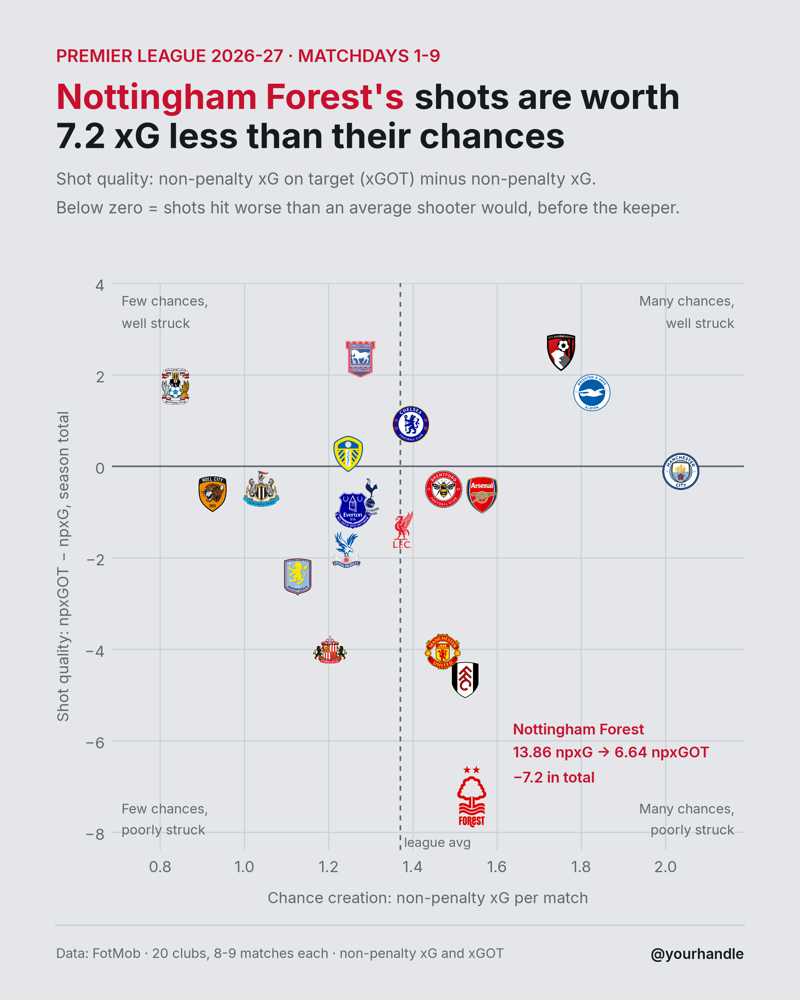

# npxG_plot

Non-penalty xG vs Non-penalty xGOT overperformance

We look at three plots comparing a club's chance creation to their shot quality, using the 2026-27 Premier League season up to matchday 9 (data scraped from FotMob). 

Chance creation is given by the average non-penalty xG per match. To compute a team's shot quality, we look at two related by slightly different stats: the ratio between a club's total accumulated npXGOT and npXG, or the difference between the two. 

The plots are generated in [xGplot.R](xGplot.R):
1. Average npxG vs average npxGOT per match
2. Average npxG vs npxGOT / npxG ratio
3. Average npxG vs npxGOT − npxG difference

## Notable outliers and facts

Nottingham Forest have by far the worst shot quality in the league: they generated 13.86 npxG in 9 matches, but their shots were worth only 6.64 npxGOT, a difference of −7.22. This is consistent rather than driven by one or two matches: Forest average −0.80 per match with little match-to-match variation.

Coventry City have simultaneously the worst average npxG and the best npxGOT to npxG ratio (1.23). Because their npxG total is so small (7.52), the ratio is sensitive to a handful of shots; on the difference they rank third (+1.75), behind Bournemouth and Ipswich.

League-wide, npxGOT is 20.14 below npxG so far this season. A shortfall this size means some combination of below-average shot execution across the league, early-season noise, and differences in how FotMob's xG and xGOT models are calibrated.
